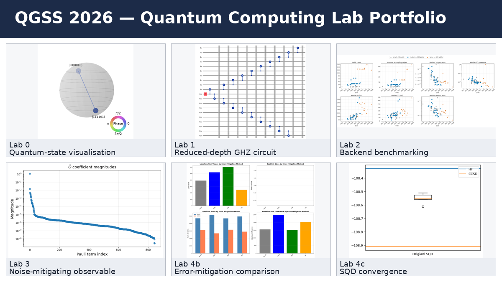

# QGSS 2026 Quantum Computing Lab Portfolio

**Author:** Jordan Loic Fono Pevetmi  
**Focus:** quantum programming, hardware-aware circuit design, noise, error mitigation, optimisation and quantum chemistry

This repository presents my hands-on work through the Qiskit Global Summer School 2026 laboratory sequence. The notebooks have been prepared for public sharing: credentials, cloud resource identifiers, Runtime job IDs, personal contact details, local paths and error tracebacks have been removed or replaced with safe placeholders.



## Laboratory overview

| Notebook | Main focus | Skills demonstrated |
|---|---|---|
| Lab 0 | Qiskit patterns and first quantum programs | mapping, transpilation, Sampler, Estimator, post-processing and state visualisation |
| Lab 1 | Circuits for real hardware | gates, Bell/GHZ states, circuit depth, heavy-hex topology and hardware-aware transpilation |
| Lab 2 | Noise, backends and benchmarking | depolarising, Pauli and thermal-relaxation noise; backend comparison; dynamic circuits |
| Lab 3 | Error mitigation | twirling, circuit boxing, NoiseLearner, structure-aware mitigation and observable bounds |
| Lab 4a | Pathways towards quantum advantage | advantage criteria, workload classification and the Quantum Advantage Tracker |
| Lab 4b | QAOA for the partition problem | QUBO/Ising mapping, QAOA, error-mitigation comparisons and Pauli-correlation encoding |
| Lab 4c | Sample-based quantum diagonalisation | N₂ active-space modelling, LUCJ state preparation, noisy-bitstring recovery, SQD and selected CI |

## Tools and technologies

Python, Qiskit SDK, Qiskit Runtime, Qiskit Addons, Qiskit Aer, PySCF, ffsim, NumPy, SciPy, Matplotlib, Jupyter Notebook and qBraid.

## Repository structure

```text
notebooks/   Sanitised, public-ready lab notebooks
media/       Selected visual outputs and a LinkedIn cover image
linkedin/    Ready-to-edit LinkedIn post and project description
docs/        Upload instructions, portfolio summary and redaction report
```

## Running the notebooks

1. Use an environment compatible with the QGSS 2026 dependencies.
2. Configure IBM Quantum credentials outside the notebook or through environment variables.
3. Replace placeholders such as `<YOUR_JOB_ID>` only in your private working copy.
4. Avoid committing credentials, cloud CRNs or Runtime job identifiers.

## Public-sharing note

These notebooks are shared as an educational portfolio. IBM and Qiskit names and original educational materials remain the property of their respective owners. The repository highlights my implementations, experiments, observations and learning process; it does not claim that every explored workload demonstrates quantum advantage.
